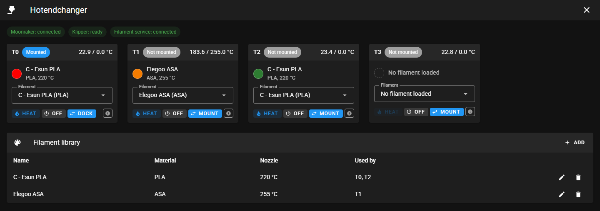

# hotendchanger [](LICENSE)

A Kalico and Klipper plugin for CxChanger hotendchangers, in particular the
[Ronin](https://github.com/jaak0b/Ronin) fork, that swaps only the hotend
between docks.

Each dock holds a complete hotend: heater block, thermistor, nozzle and
hotend fan. The extruder motor and the part cooling fan stay fixed on the
carriage, and every hotend keeps its own filament loaded. A tool change is
dock motion plus an electrical remap of heater, thermistor and fan to the
new hotend. There is no retract, no unload and no filament handoff.

Every hotend is a standard `[extruderN]` section, so PID tuning, `M104`/`M109`
`T<n>` and the temperature display in Mainsail come from the firmware
itself. The plugin adds the `T<n>` commands, per-tool nozzle offsets, dock
and toolhead sensors, and an optional filament library that OrcaSlicer can
sync from.



*The web page.*

## What you need

- **Kalico or stock Klipper.** The plugin runs on both from the same files.
  Python 3, no third-party packages.
- **Moonraker**, for the update manager entry and the optional filament
  service.
- **Mainsail**, for the optional web page and its sidebar entry. The page is
  served through the same nginx site as Mainsail.
- **CxChanger hotendchanger hardware**, in particular the
  [Ronin](https://github.com/jaak0b/Ronin) fork: one extruder motor on the
  carriage and one dock per hotend.
- **[eddy_tool_calibration](https://github.com/jaak0b/kalico-eddy-offset-calibration)**
  to measure the gcode nozzle offsets. This plugin stores and applies
  offsets; it does not measure them.
- **Optional sensors:** one dock sensor per tool, a toolhead sensor that
  reads whether a hotend is mounted, or both.

## Getting started

1. Run the installer and answer its questions about tool count, extruder sections and sensors, see [Install](#install) and [First install setup](docs/installer.md#first-install-setup).
2. Fill in the pins, dock positions and hotend values in `hotendchanger.cfg`, see [Config reference](#config-reference).
3. Adapt `pickup_gcode` and `dropoff_gcode` to your dock motion, see [Tool change templates](#tool-change-templates).
4. Restart Klipper and run [`INITIALIZE_HOTENDCHANGER`](#commands). Without dock sensors, run `INITIALIZE_HOTENDCHANGER T=0` with T0 on the carriage.
5. Home and run your first tool change, see [First tool change](#first-tool-change).
6. Measure the nozzle offsets with eddy_tool_calibration, see [Nozzle offsets](#nozzle-offsets).
7. Add `UNSELECT_TOOL` to your `PRINT_END` macro if the toolhead should end empty, see [Commands](#commands).
8. Open the web page from the Hotendchanger entry in Mainsail's sidebar, see [Web page and filament library](#web-page-and-filament-library).
9. Set up OrcaSlicer filament sync, see [OrcaSlicer filament sync](#orcaslicer-filament-sync).

## Install

```
cd ~
git clone https://github.com/jaak0b/kalico-hotendchanger
cd kalico-hotendchanger
sh install.sh
```

The installer guides you through everything: press Enter to accept the
defaults. It lists what you still have to fill in afterwards. If a print is
running, it restarts nothing and prints the restart commands instead.

Details: [docs/installer.md](docs/installer.md)

## Config reference

One `[hotendchanger]` section, plus one `[hotendchanger_tool T<n>]` section
per tool, numbered from `T0` upward with no gaps. Options left blank depend
on your machine and have no default.

**Remove any `[gcode_macro T0]` (and up) or `[gcode_macro UNSELECT_TOOL]`
from your config.** The plugin registers these commands itself and reports
a duplicate as a config error.

### Required

```
[hotendchanger]
pickup_gcode:
#   A list of G-Code commands to pick up a hotend at its dock. This
#   parameter must be provided. The template is shared by all tools and
#   is evaluated using the standard command template expansion, with
#   the tool being picked up bound as "tool" (fields: number, name,
#   extruder, params) and its params_* values bound as "params".
dropoff_gcode:
#   A list of G-Code commands to drop off the mounted hotend at its
#   dock. This parameter must be provided. Same template context as
#   pickup_gcode, bound to the tool being dropped off.
```

### Tools

```
[hotendchanger_tool T0]
extruder:
#   Name of this tool's extruder section (for example "extruder" or
#   "extruder1"). The section must exist in the config. This parameter
#   must be provided.
#gcode_x_offset: 0
#gcode_y_offset: 0
#gcode_z_offset: 0
#   Gcode offset applied while this tool is active. The plugin replaces
#   only this tool's component of the gcode origin, so babystepping
#   applied on top is preserved. SET_TOOL_OFFSET with SAVE=1 writes
#   measured values back into these options. The default is 0 on each
#   axis.
#pressure_advance:
#pressure_advance_smooth_time:
#   Pressure advance used while this tool is active, programmed into
#   the extruder stepper at every tool change. Left out, the tool uses
#   the values configured in the [extruder] section. Do not set
#   pressure_advance in a heater-only [extruderN] section; the firmware
#   rejects it as an unused option.
#params_dock_x:
#params_dock_y:
#params_dock_z:
#   Any option starting with "params_" defines a named value passed to
#   the pickup and dropoff templates as params.<name> for this tool.
#   Put the dock coordinates and other per-tool values here. The names
#   are yours to choose; they must match what the templates read.
```

`[extruder]` is T0 and is a normal extruder section with step pins: it
drives the one extruder motor for every tool. `[extruder1]` and up have no
step pins, so the firmware builds them as heater-only extruders. Give each
hotend its fan with a `[heater_fan]` whose `heater` is that hotend's
extruder section:

```
[extruder1]
heater_pin:
sensor_type:
sensor_pin:
control: pid
pid_Kp:
pid_Ki:
pid_Kd:
min_temp:
max_temp:
nozzle_diameter:
filament_diameter:

[heater_fan hotend1_fan]
pin:
heater: extruder1
```

### Sensors

Either every tool sets a `detect_pin` or none does; a mix is a config
error. `toolhead_detect_pin` works with or without dock sensors.

```
[hotendchanger_tool T0]
#detect_pin:
#   Endstop-style pin for this tool's dock sensor. Triggered means the
#   hotend is sitting in its dock; untriggered means it is not (it is
#   mounted on the carriage, or missing). Use the usual "!" prefix to
#   normalize your switch's polarity to that convention. The default is
#   no dock sensor.

[hotendchanger]
#toolhead_detect_pin:
#   Endstop-style pin reading whether some hotend is mounted on the
#   toolhead; triggered means a hotend is held. The pin cannot tell
#   which tool. Normalize polarity with the usual "!" prefix. The
#   default is no toolhead sensor.
#detect_settle_time: 1.0
#   Seconds. While printing, how long toolhead_detect_pin must read
#   untriggered continuously before the tool loss response fires (a
#   contact bounce filter for the coupling under print vibration).
#   While no print is running, how long after the last detect pin
#   change a manual tool swap may settle before detection runs again.
#   Must be above 0. The default is 1.0.
#detect_report_time: 0.05
#   Seconds the pin checks during a tool change wait after motion
#   finishes for the sensor report to arrive; a failed reading is read
#   again once after another window before the change is declared
#   failed. Raise this on slow transports such as CAN. Must be above 0.
#   The default is 0.05.
```

### Optional

```
[hotendchanger]
#before_change_gcode:
#   A list of G-Code commands run at the start of a tool change, before
#   any offset or motion change. The template receives "old_tool" (None
#   when no tool is mounted) and "new_tool" (None for UNSELECT_TOOL).
#   Read new_tool fields only inside ; otherwise
#   UNSELECT_TOOL fails with a template error and leaves the plugin in
#   the error state. The default is to run nothing.
#after_change_gcode:
#   A list of G-Code commands run after a tool change completes, once
#   the new offset is applied and the temperature wait, if any, has
#   finished; for UNSELECT_TOOL, once the dropoff is done. Same template
#   context as before_change_gcode. The default is to run nothing.
#temp_wait_tolerance: 2.0
#   Temperature window (in degrees Celsius) around the new tool's
#   target used after pickup. If the new hotend has a nonzero target,
#   the change waits until its temperature is within this value of the
#   target, in either direction, so a preheated hotend overshooting on
#   the way down completes the wait as soon as it re-enters the window.
#   Must be above 0. The default is 2.0.
```

### Filament service

```
[hotendchanger]
#filament_reply_timeout: 10.0
#   Seconds a filament console command waits for the filament service
#   to answer before the console reports that it is not answering. The
#   answer waits for the current G-Code line to finish, so a long
#   command (a heating wait, homing) can make it late; a late answer is
#   still printed. Must be above 0. The default is 10.0.
```

The filament service itself has no config section. It reaches Moonraker
through `<printer_data>/comms/moonraker.sock`, set by `--printer-data` at
install time.

### Tool change templates

The setup writes these starter templates. They move straight to the dock
position and do not couple or release anything: replace them with your
CxChanger dock motion before the first tool change.

```
[hotendchanger]
pickup_gcode:
    G1 X{params.dock_x} Y{params.dock_y} F6000
    G1 Z{params.dock_z} F600
dropoff_gcode:
    G1 X{params.dock_x} Y{params.dock_y} F6000
    G1 Z{params.dock_z} F600
```

Template fields are listed in
[docs/how-it-works.md](docs/how-it-works.md#template-context).

### First tool change

1. Run `G28`. A tool change is refused until X, Y and Z are homed.
2. Run `HOTENDCHANGER_STATUS` and check that the active tool and every
   sensor reading match the machine.
3. Run `T1`, then `T0`. Keep a hand on the emergency stop the first time.

A change that fails partway leaves the plugin in the `error` state.
Check the hotend by hand, then run `INITIALIZE_HOTENDCHANGER` to clear it.

### Nozzle offsets

Measure the offsets with
[eddy_tool_calibration](https://github.com/jaak0b/kalico-eddy-offset-calibration)
and follow its README for the setup. This plugin receives the values
through [`SET_TOOL_OFFSET`](#commands).

## Commands

| Command | What it does |
| --- | --- |
| `T<n>` | Change to tool `n`. |
| `UNSELECT_TOOL` | Dock the mounted hotend and leave the toolhead empty. |
| `SET_TOOL_OFFSET T=<n> [X=<x>] [Y=<y>] [Z=<z>] [SAVE=1]` | Set a tool's gcode offset. |
| `HOTENDCHANGER_STATUS` | Print the plugin state and sensor readings as labeled rows. |
| `INITIALIZE_HOTENDCHANGER [T=<n>]` | Resolve the mounted tool and clear the `error` state. |
| `HOTENDCHANGER_FILAMENT_ADD NAME="<name>" MATERIAL=<material> NOZZLE_TEMP=<temp>` | Add a filament to the library. |
| `HOTENDCHANGER_FILAMENT_ASSIGN T=<n> NAME="<name>" COLOR=<RRGGBB>` | Record the filament and color tool `n` holds. |
| `HOTENDCHANGER_FILAMENT_ASSIGN T=<n> CLEAR=1` | Record that tool `n` holds no filament. |
| `HOTENDCHANGER_FILAMENT_COLOR T=<n> COLOR=<RRGGBB>` | Change the color of tool `n`'s filament. |
| `HOTENDCHANGER_FILAMENT_LIST` | Print each tool's filament, then the library. |

Per-command behavior, refusals and the fields macros can read from
`printer.hotendchanger` are in
[docs/how-it-works.md](docs/how-it-works.md#commands-in-detail).

## Web page and filament library

Open the page from the Hotendchanger entry in Mainsail's sidebar; reload
Mainsail once after installing to make the entry appear. It is served at
`http://<printer>/hotendchanger/`.

**Add the network you browse from to `trusted_clients` in the
`[authorization]` section of `moonraker.conf`.** The page has no login, so
Moonraker refuses it from any other network.

Cards, buttons and presence chips: [docs/web-page.md](docs/web-page.md).

## OrcaSlicer filament sync

The filament service publishes each tool's filament to Moonraker, where
OrcaSlicer reads it: filament slot N is tool N.

**Do not run AFC or Happy Hare on the same printer.** They write the same
Moonraker data, and each overwrites the other's entries.

1. In OrcaSlicer, open Preferences, then Developer, then Experimental
   Features, and enable "Use printer agents instead of print hosts".
2. In the printer profile, open Basic information, then Advanced. Set
   "Printer Agent" to Moonraker and enter the printer's host and API key.
3. In the Filament header, click "Synchronize filament list from AMS". On
   an empty plate the list syncs directly; otherwise choose "Overwriting".

Limits:

- Orca picks a filament profile by material only, not by the filament
  name: a user profile of that material if one exists, otherwise the
  Generic profile.
- Colors are set exactly.
- Overwriting does not remove extra filament slots already in the project.
- The experimental setting applies to every printer in OrcaSlicer and can
  block sending to printers whose profile is based on a vendor model, see
  [docs/filament-service-api.md](docs/filament-service-api.md#orcaslicer-experimental-setting).

## Updating, uninstalling, troubleshooting

**Updating.** With the update entry, update from Mainsail's update screen.
Without it, run `git pull` in `~/kalico-hotendchanger` and restart Klipper
(and `hotendchanger-filament`, if installed).

**Uninstalling.** See [docs/installer.md](docs/installer.md#uninstalling).

**Troubleshooting.**

- `cannot register gcode command T0`: a `[gcode_macro T0]` (or
  `UNSELECT_TOOL`) still exists. Remove it.
- A tool change is refused: run `HOTENDCHANGER_STATUS`. In the `error` or
  `unknown` state, check the hotend and run `INITIALIZE_HOTENDCHANGER`.
- The print paused after a tool change: the sensors did not confirm the
  change. The console message names each failed check with the raw
  readings. Fix the hotend, run `INITIALIZE_HOTENDCHANGER`, then `RESUME`.
- The print paused and all heaters are off: the toolhead sensor lost the
  hotend. Re-seat it, run `INITIALIZE_HOTENDCHANGER` (`T=<n>` without dock
  sensors), then `RESUME`.
- A filament command reports the service is not answering: check
  `systemctl status hotendchanger-filament`.
- The web page does not load: check `trusted_clients`, then
  [docs/web-page.md](docs/web-page.md#what-the-installer-changes).

## Further documentation

- [How it works](docs/how-it-works.md): tool change sequence, states, detect
  pin rules, tool presence, tool loss protection, offset handling, commands
  in detail, status fields, template context and limitations.
- [Filament service and API](docs/filament-service-api.md): service
  architecture, console command forwarding, the Moonraker API for other
  programs and the OrcaSlicer experimental setting.
- [Web page](docs/web-page.md): page layout, chips, what the installer
  changes in nginx and Mainsail, and removal.
- [Design document](docs/design.md): architecture and the firmware surfaces
  the plugin depends on.

## License

GNU GPLv3, see [LICENSE](LICENSE).
